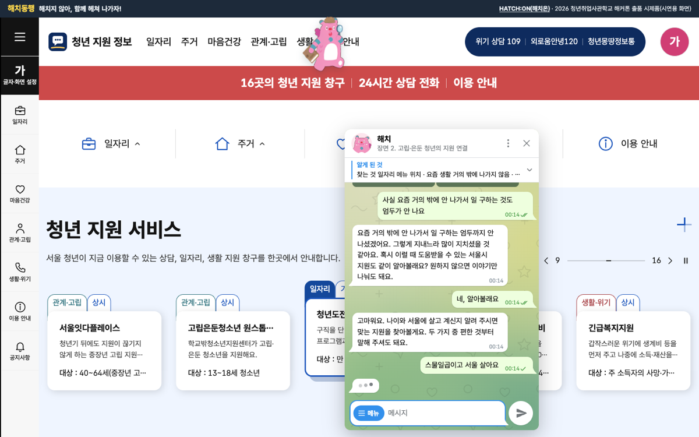
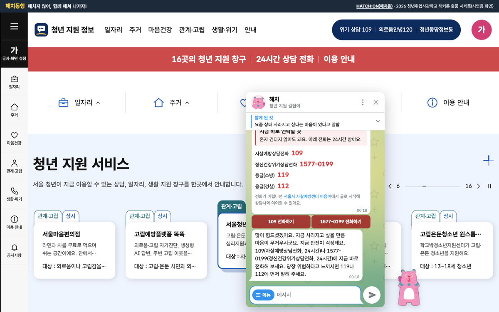
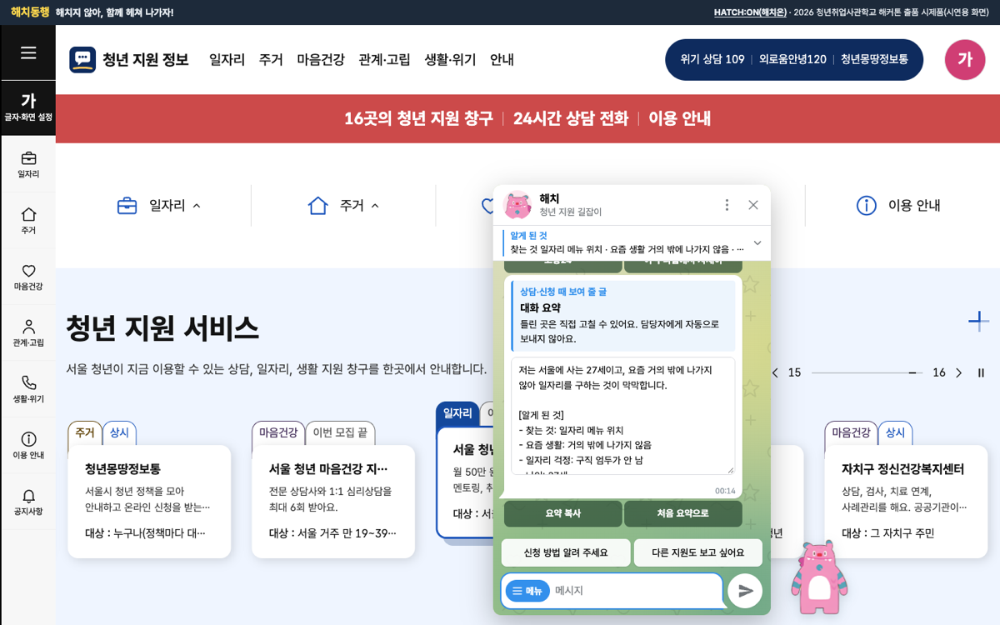

# 해치동행

청년 지원 정보 누리집에 AI 안내 캐릭터 해치를 붙인 시제품



| 기간 | 대회 | 결과 | 배포 |
|---|---|---|---|
| 2026.10.14 ~ 20 | 청년취업사관학교 해커톤 HATCH:ON | 참가 | https://haechi-donghaeng.vercel.app |

## 문제의식

- 서울에는 은둔·고립 청년 대상 상담, 일자리, 주거, 마음건강 지원이 이미 다수
- 지원이 필요한 청년일수록 누리집 메뉴에서 맞는 사업을 찾아 신청까지 가기 어려움
- 필요한 것은 새 서비스 추가보다 기존 지원으로 이어 주는 길

## 해결 방법

- 누리집 안에 말을 걸 수 있는 안내자 배치
- 개인적인 질문은 허락을 받은 뒤에만 진행
- 추천은 조사해 둔 기존 서비스 안에서만 선택, 추천한 서비스는 화면에서 직접 가리킴
- 카드의 기관, 조건, 연락처, 출처는 자료에서만 가져오고 모델은 맞는 이유 한 줄만 작성

## 주요 기능

- 해치 캐릭터: 화면 아래와 바로가기·카드 위를 이동, 누르면 말풍선 대화창
- 의사 확인: 개인적인 질문 전에 의사 확인, 거절 시 일반 안내로 복귀
- 위기 연락처 카드: 위기 낱말이 보이면 AI 답을 기다리지 않고 109, 1577-0199, 119·112 카드 표시. 돌려 말한 위기 신호는 모델이 판단해 같은 카드 표시



- 서비스 추천 카드와 대화 요약 카드



- 대화 미저장
- 시연 장면: 주소 끝 `#demo1`(일반 시민의 정보 찾기), `#demo2`(고립·은둔 청년을 지원으로 연결)

## 만들며 부딪힌 문제

- 고립 신호에 의사 확인 없이 나이와 거주지 질문
  - 원인: 이용자의 "네"를 허락으로 읽는 모델, 프롬프트 예시만으로는 완전 차단 불가
  - 해결: 서버가 앞 답을 확인해 의사 확인 질문으로 교체
- "오늘 죽을 거예요" 같은 활용형과 답 작성 중 입력에서 위기 카드 미표시
  - 원인: 낱말 일치 방식의 검사, 응답 대기 중 검사 누락
  - 해결: 활용형까지 검사, 대기 중에도 즉시 카드 표시
- 기획서에 적은 연결 사업이 이미 모집 종료
  - 원인: 기획 단계 조사와 실제 모집 일정의 차이
  - 해결: 자료마다 모집 상태 칸 추가, 종료 사업은 추천 제외 후 상시 창구 우선 안내

## 돌아본 점

- 처음으로 AI 모델 API 연결: 대화형 안내 기능을 직접 구현해 본 첫 작업
- 프롬프트 규칙 설계 미숙: 규칙 짜는 법을 잘 몰라 답의 품질이 낮았고, 대표 기능을 보여 주는 시제품으로는 부적합. 규칙을 넣어도 모델이 내부 자료를 드러내는 말을 가끔 해서 서버에서 거르는 장치를 뒤늦게 추가
- 주제와 문제 정의는 만족: 누구의 어떤 문제인지 정하는 과정은 이전 작업보다 분명하게 진행
- 해결을 드러내는 표현 부족: 정한 문제를 풀어 가는 모습을 화면과 시연에서 매끄럽게 보여 주지 못함
- 누구나 신라의 화면 틀을 그대로 재사용: 예시 누리집을 내용만 바꿔 만들다 보니 화면 대부분이 배경 누리집이고, 정작 해결에 해당하는 해치 대화는 화면 아래 작은 말풍선
- 연결이 복사에서 끝남: 대화 요약을 기관에 직접 전달하는 길을 만들지 못해, 기존 지원으로 이어 준다는 해결이 마지막 단계에서 끊김
- 기존 AI 상담과의 구분 부족: 서울시에 이미 있는 AI 상담과 무엇을 나눠 맡는지 정하지 못한 채 제출
- 짧은 제작 기간: 주제 회의가 10월 17일, 마감이 20일이라 기획 정리와 시제품 제작이 사흘 안에 진행

## 기술

- Next.js 16, React 19, TypeScript, Anthropic SDK(Claude Haiku), zod
- 모델 답은 정해 둔 형식(말, 포즈, 단계, 선택지, 가리킬 요소, 추천, 위기 여부, 요약)으로만 수신
- 서버가 목록 밖 서비스, 모집 종료 사업, 이용자가 말한 나이·거주지와 맞지 않는 사업을 한 번 더 거름
- 시험 문장을 일반 안내, 고립·은둔, 위기, 조건 밖, 엇나간 입력으로 나눠 실제 API로 돌리고 채점
- 화면 틀은 앞서 만든 [누구나 신라](https://github.com/noru-0731/sillaforall)의 KRDS 기반 틀 재사용, 해치 그림은 서울시 공개 응용동작 자료
- AI 도구: 기획과 구현을 AI 코딩 도구(Claude Code)로 진행, 안내 대화는 Claude Haiku

| 부분 | 파일 |
|---|---|
| 해치 화면 층 | `src/components/haechi/HaechiLayer.tsx` |
| 서버 경로 | `src/app/api/haechi/route.ts` |
| 모델 호출과 답 거르기 | `src/lib/haechi/core.ts` |
| 시스템 프롬프트 | `src/lib/haechi/prompt.ts` |
| 연결 실패 때 쓰는 대본 흐름 | `src/lib/haechi/fallback.ts` |
| 위기 낱말 | `src/lib/haechi/crisis.ts` |
| 서비스, 상황, 출처 자료 | `src/data/` |
| 시험 문장과 채점 | `tests/scenarios.json`, `scripts/run-eval.ts` |

## 자료 출처 · 실행

- 서비스, 상황, 출처 자료: `src/data/`
- 해치 그림: 서울시 공개 해치 응용동작 자료

```bash
npm install
cp .env.local.example .env.local   # ANTHROPIC_API_KEY 입력
npm run dev
```

키가 없으면 대본 흐름으로 안내 진행
